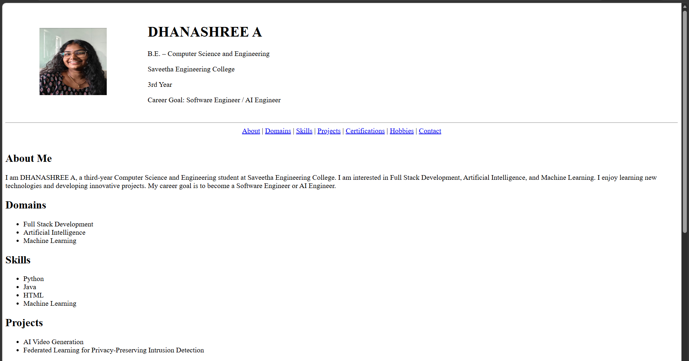
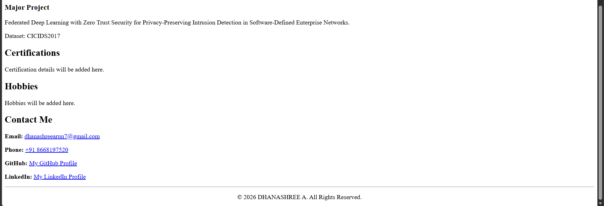

# Ex01 Portfolio
## Date:29.10.2026

## AIM
To create a Portfolio using HTML and CSS.

## ALGORITHM
### STEP 1
Create an HTML file (index.html)

### STEP 2
Create a CSS file (style.css)

### STEP 3
Include a navigation bar with links to different sections.

### STEP 4
Add structured sections for introduction, about, projects, and contact details.

### STEP 5
Define global styles for fonts, colors, and layout.

### STEP 6
Style the header, navigation bar, and sections.

### STEP 7
Use Flexbox or CSS Grid for layout design.

### STEP 8
Add hover effects and transitions for interactivity.

### STEP 9
Add Images and Media.

### STEP 10
Use optimized images for a professional look.

### STEP 11
Open the HTML file in a browser to check layout and functionality.

### STEP 12
Fix styling issues and refine content placement.

### STEP 13
Deploy the Portfolio.

### STEP 14
Upload to GitHub Pages for free hosting.

## PROGRAM

```html
<!DOCTYPE html>
<html lang="en">
<head>
    <meta charset="UTF-8">
    <meta name="viewport" content="width=device-width, initial-scale=1.0">
    <title>DHANASHREE A - Portfolio</title>
</head>

<body bgcolor="white" text="black">

    <header>
        <table width="100%" cellpadding="15">
            <tr>
                <td width="20%" align="center">
                    
                </td>

                <td>
                    <h1>DHANASHREE A</h1>
                    <p>B.E. – Computer Science and Engineering</p>
                    <p>Saveetha Engineering College</p>
                    <p>3rd Year</p>
                    <p>Career Goal: Software Engineer / AI Engineer</p>
                </td>
            </tr>
        </table>
        <hr>
    </header>

    <nav>
        <center>
            <a href="#about">About</a> |
            <a href="#domains">Domains</a> |
            <a href="#skills">Skills</a> |
            <a href="#projects">Projects</a> |
            <a href="#certification">Certifications</a> |
            <a href="#hobbies">Hobbies</a> |
            <a href="#contact">Contact</a>
        </center>
    </nav>

    <br>

    <section id="about">
        <h2>About Me</h2>
        <p>
            I am DHANASHREE A, a third-year Computer Science and
            Engineering student at Saveetha Engineering College.
            I am interested in Full Stack Development, Artificial
            Intelligence, and Machine Learning. I enjoy learning
            new technologies and developing innovative projects.
            My career goal is to become a Software Engineer or
            AI Engineer.
        </p>
    </section>

    <section id="domains">
        <h2>Domains</h2>
        <ul>
            <li>Full Stack Development</li>
            <li>Artificial Intelligence</li>
            <li>Machine Learning</li>
        </ul>
    </section>

    <section id="skills">
        <h2>Skills</h2>
        <ul>
            <li>Python</li>
            <li>Java</li>
            <li>HTML</li>
            <li>Machine Learning</li>
        </ul>
    </section>

    <section id="projects">
        <h2>Projects</h2>

        <ul>
            <li>AI Video Generation</li>
            <li>
                Federated Learning for Privacy-Preserving
                Intrusion Detection
            </li>
        </ul>

        <h3>Major Project</h3>
        <p>
            Federated Deep Learning with Zero Trust Security
            for Privacy-Preserving Intrusion Detection in
            Software-Defined Enterprise Networks.
        </p>
        <p>Dataset: CICIDS2017</p>
    </section>

    <section id="certification">
        <h2>Certifications</h2>
        <p>Certification details will be added here.</p>
    </section>

    <section id="hobbies">
        <h2>Hobbies</h2>
        <p>Hobbies will be added here.</p>
    </section>

    <section id="contact">
        <h2>Contact Me</h2>

        <p>
            <b>Email:</b>
            <a href="mailto:dhanashreearun7@gmail.com">
                dhanashreearun7@gmail.com
            </a>
        </p>

        <p>
            <b>Phone:</b>
            <a href="tel:+918668197520">
                +91 8668197520
            </a>
        </p>

        <p>
            <b>GitHub:</b>
            <a href="https://github.com/Dhanaarun"
               target="_blank">
                My GitHub Profile
            </a>
        </p>

        <p>
            <b>LinkedIn:</b>
            <a href="https://www.linkedin.com/in/dhanashree-arun-ab8119392/"
               target="_blank">
                My LinkedIn Profile
            </a>
        </p>
    </section>

    <hr>

    <footer>
        <center>
            <p>
                &copy; 2026 DHANASHREE A.
                All Rights Reserved.
            </p>
        </center>
    </footer>

</body>
</html>
```

## OUTPUT





## RESULT
The program for creating Portfolio using HTML and CSS is executed successfully.
